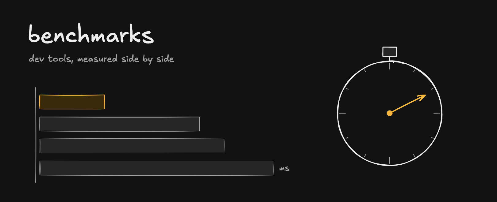

# benchmarks

Developer tools measured side by side: same machine, same data, each tool's documented settings plus the tuning named in each folder, and the scripts to run it yourself. One question per benchmark, one folder each.

| Benchmark | Question | Result |
|---|---|---|
| [vector-search](vector-search/) | How fast do DuckDB vss, pgvector, LanceDB and sqlite-vec answer a top-10 query on 1.18M vectors, all at the same recall (one client)? | DuckDB 3.2 ms, pgvector 10.4 ms, LanceDB 16.5 ms, sqlite-vec 150 ms (exact) |
| [llm-trace-bytes](llm-trace-bytes/) | How many bytes does each LLM tracing SDK send per call with a 32 KB prompt? | OpenInference 65.4 KB, OpenLLMetry 32.9 KB, Langfuse 13.8 KB |

## How these are run

- Each tool with its defaults first, then any setting its own docs recommend, named in the results.
- Speed is compared at equal accuracy where accuracy can differ.
- Several rounds, interleaved, median reported; the run count is in each folder's README.
- Raw results are in the folder as `results.jsonl` where a run has more than one round.

Found a mistake or a fairer setting? Open an issue with the change and I'll rerun it.

## License

[MIT](LICENSE)
