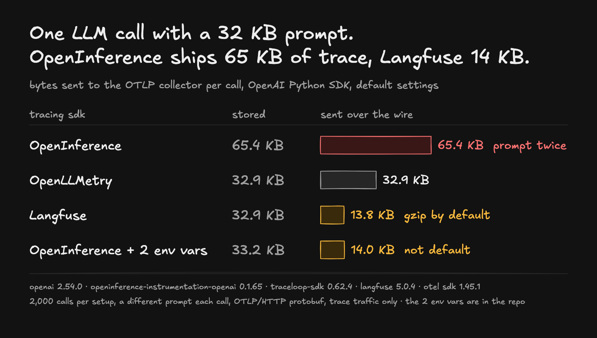

# llm-trace-bytes

How many bytes does each LLM tracing SDK send to the collector for one OpenAI call, with its default settings?



## Result

Bytes per call exported over OTLP/HTTP:

| SDK | 1 KB prompt: stored / sent | 32 KB prompt: stored / sent |
|---|---|---|
| OpenInference | 3.4 KB / 3.4 KB | 65.4 KB / 65.4 KB |
| OpenInference + `OPENINFERENCE_HIDE_INPUT_MESSAGES=true` | 2.2 KB / 2.2 KB | 33.2 KB / 33.2 KB |
| OpenInference + `OTEL_EXPORTER_OTLP_COMPRESSION=gzip` | 3.4 KB / 0.6 KB | 65.4 KB / 27.4 KB |
| OpenInference + both | – | 33.2 KB / 14.0 KB |
| OpenLLMetry | 1.9 KB / 1.9 KB | 32.9 KB / 32.9 KB |
| OpenLLMetry + `OTEL_EXPORTER_OTLP_COMPRESSION=gzip` | 1.9 KB / 0.6 KB | 32.9 KB / 13.8 KB |
| Langfuse (gzip by default) | 1.9 KB / 0.55 KB | 32.9 KB / 13.8 KB |

"Stored" is the decompressed body, what a backend keeps; "sent" is what goes over the wire. Only trace traffic is counted: OpenLLMetry also exports metrics by default, but no metrics request reached the receiver during these runs. Bytes per call were identical in every round; [results.jsonl](results.jsonl) has the default-setting rows (5 rounds each), and the rows with environment variables come from one run each.

**Why OpenInference is twice the size:** every SDK creates one span per call, but OpenInference stores the prompt twice, in `input.value` (the whole request JSON) and in `llm.input_messages.*.message.content`. OpenLLMetry keeps it once in `gen_ai.input.messages`, Langfuse once in `langfuse.observation.input`. [decode.py](decode.py) prints the attribute sizes of one exported span.

## Setup

- OpenAI Python SDK 2.54.0 calling a local mock of the chat API that answers instantly ([mock.mjs](mock.mjs)). The same file runs an OTLP receiver that counts bytes (on the wire and decompressed) and drops the data.
- One virtualenv per SDK, each with its defaults:
  - OpenInference: `openinference-instrumentation-openai` 0.1.65, OpenTelemetry SDK 1.45.1, `OTLPSpanExporter` + `BatchSpanProcessor`
  - OpenLLMetry: `traceloop-sdk` 0.62.4, `Traceloop.init`, telemetry off
  - Langfuse: `langfuse` 5.0.4, `from langfuse.openai import OpenAI`
- A different prompt on every call (random words), so gzip ratios look like real prompts rather than repeated text.
- 2,000 calls per setup.
- The receiver only counts and drops what it gets; it does not test what each backend does with the data once it arrives.

## Run it

One virtualenv per SDK:

```sh
python -m venv venv-baseline && venv-baseline/bin/pip install openai==2.54.0
python -m venv venv-openllmetry && venv-openllmetry/bin/pip install openai==2.54.0 traceloop-sdk==0.62.4
python -m venv venv-openinference && venv-openinference/bin/pip install openai==2.54.0 openinference-instrumentation-openai==0.1.65 opentelemetry-sdk==1.45.1 opentelemetry-exporter-otlp-proto-http==1.45.1
python -m venv venv-langfuse && venv-langfuse/bin/pip install openai==2.54.0 langfuse==5.0.4
```

Then:

```sh
node mock.mjs &                      # API on :8090, OTLP receiver on :4318
venv-openinference/bin/python bench.py openinference plain 2000 1 32000
```

Run `bench.py` with the virtualenv of the SDK named in the first argument (`baseline`, `openllmetry`, `openinference`, `langfuse`). It prints one JSON line; `export_bytes_per_call` is the wire size and `export_raw_bytes_per_call` the decompressed size. Set `DUMP_DIR` for `mock.mjs` to save one body per path, then `python decode.py <file>`.
