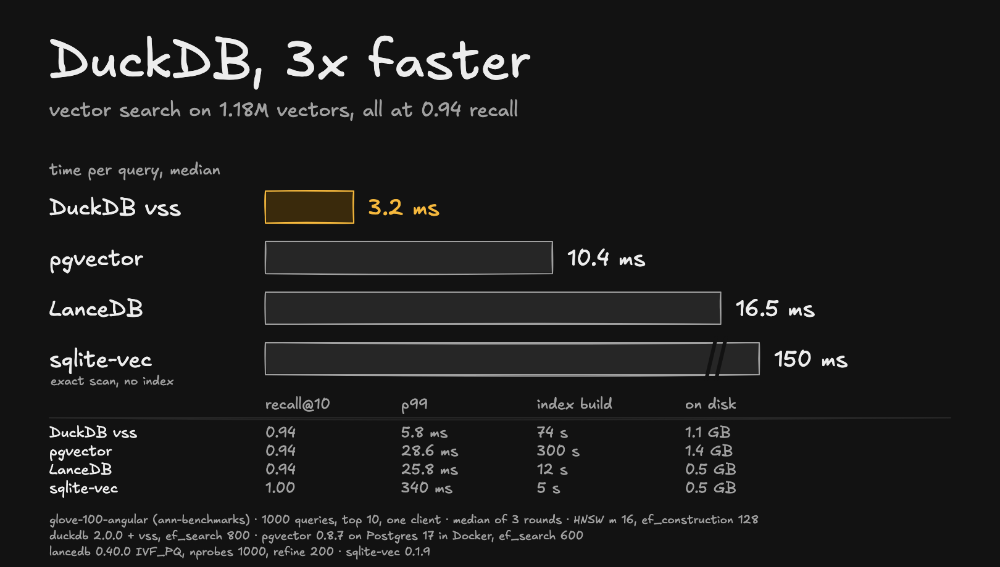

# vector-search

How fast do four embedded or self-hosted vector engines answer a top-10 query on 1.18M vectors, when each is tuned to the same recall?



## Result

All at recall@10 ≈ 0.94, one client, median of 3 interleaved rounds of 1000 queries:

| Engine | Index | Search setting | recall@10 | p50 | p99 | Index build | On disk |
|---|---|---|---|---|---|---|---|
| DuckDB 2.0.0 + vss | HNSW, m 16, ef_construction 128 (defaults) | `hnsw_ef_search = 800` | 0.939 | 3.2 ms | 5.8 ms | 74 s | 1.1 GB |
| pgvector 0.8.7, Postgres 17 | HNSW, m 16, ef_construction 128 | `hnsw.ef_search = 600` | 0.939 | 10.4 ms | 28.6 ms | 300 s | 1.4 GB |
| LanceDB 0.40.0 | IVF_PQ, 10 sub-vectors | `nprobes 1000, refine_factor 200` | 0.939 | 16.5 ms | 25.8 ms | 12 s | 0.5 GB |
| sqlite-vec 0.1.9 | none (exact scan) | – | 1.000 | 150 ms | 340 ms | 5 s | 0.5 GB |

With each engine's default search settings, recall@10 was 0.75 (DuckDB), 0.72 (pgvector) and 0.29 (LanceDB), so comparing defaults compares different accuracy.

Both HNSW indexes use the same graph settings, m 16 and ef_construction 128 (DuckDB vss's defaults). With pgvector's own default ef_construction of 64, it needed `ef_search = 1000` to reach the same recall and took 14.9 ms per query.

## Setup

- **Data:** `glove-100-angular` from [ann-benchmarks](https://github.com/erikbern/ann-benchmarks): 1,183,514 vectors of 100 dimensions, cosine distance, with exact neighbours for the test queries. Vectors are normalised once so every engine sees the same input.
- **Queries:** the first 1000 test queries, after 100 warm-up queries that are not measured. Time per query is measured in the client, one query at a time.
- **pgvector** runs in Docker (`pgvector/pgvector:pg17`) with `shared_buffers = 2GB` and the index prewarmed (`pg_prewarm`), following pgvector's advice to keep the index in memory. At the default 128 MB it was about 2.5x slower. The client-to-container round trip was about 0.25 ms per query. The index was built with `maintenance_work_mem = 1536MB`.
- **LanceDB:** the default `IVF_PQ` index splits vectors into dim/16 sub-vectors; 100 is not a multiple of 16, so it falls back to a single sub-vector and recall drops to about 0.05. This run sets 10 sub-vectors of 10 dimensions; other LanceDB index types (such as HNSW-based ones) were not tested.
- **DuckDB vss:** HNSW index persistence is marked experimental in DuckDB.
- **sqlite-vec** has no approximate index; it scans every vector and serves as the exact baseline.
- Each run checks the query plan (`EXPLAIN` for pgvector and DuckDB, `explain_plan` for LanceDB) to make sure the index is used.

## Run it

```sh
pip install -r requirements.txt
mkdir -p data && curl -L -o data/glove-100-angular.hdf5 http://ann-benchmarks.com/glove-100-angular.hdf5
docker run -d --name pgbench -e POSTGRES_PASSWORD=bench -p 5433:5432 --shm-size=2g pgvector/pgvector:pg17

python run.py duckdb --knob 800
python run.py pgvector --knob 1000
python run.py lancedb --knob 1000:200
python run.py sqlitevec
```

`--train 50000 --queries 100` runs a quick smoke test on a slice of the data. Each run appends a line to `results.jsonl`; the rows in this folder are marked `default`, `sweep` (finding the setting for equal recall), `final`, and `superseded` (the earlier pgvector index with ef_construction 64).
